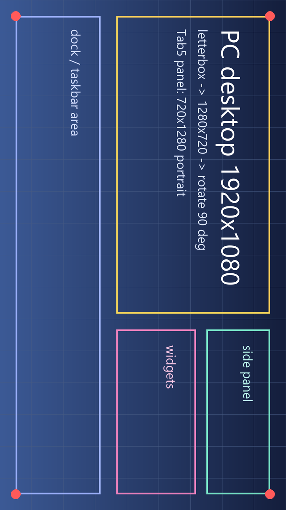

# PC 屏幕 → M5Stack Tab5（ESP32-P4）

用 Python 截取 PC 桌面，压缩后通过 USB 或 Wi-Fi 送进 **M5Stack Tab5** 的 ESP32-P4，
落进 PSRAM，再用 P4 的**硬件 JPEG 解码器**解出来画到 5 寸 1280×720 MIPI-DSI 屏上。

```
┌───────────── PC ─────────────┐          ┌──────────── M5Stack Tab5 (ESP32-P4) ────────────┐
│ mss 截图                      │          │                                                  │
│   ↓ 等比缩放 + 黑边 letterbox │  帧协议   │ scr_reader 任务：找帧头 → 校验 CRC → 存 PSRAM 槽位 │
│   ↓ 旋转 90°（横屏对横屏）     │ ───────▶ │        ↓ 双缓冲队列                                │
│ Pillow 编码 JPEG              │  22B 头   │ scr_decoder 任务：硬件 JPEG 解码 → RGB565          │
│   ↓ 打上帧头 + CRC32          │ + 负载    │        ↓ 居中拷贝                                 │
│ 写串口 / TCP socket           │ ◀─────── │ 720×1280 DPI 双帧缓冲 → MIPI-DSI 屏                │
└───────────────────────────────┘  LOG/STAT │ PSRAM：2×512 KB 帧槽 + 解码缓冲 + 2 帧缓冲         │
                                └──────────────────────────────────────────────────┘
```

支持两条链路，编译时用 Kconfig 二选一，PC 端只换一个参数：

| 链路 | 命令 | 需要额外准备 | 实测/预期带宽 |
| --- | --- | --- | --- |
| **USB-Serial/JTAG**（默认） | `--serial COM7` | 无，插上烧写用的那根 USB-C 线即可 | USB FS 12 Mbps，约 0.5–1 MB/s → 720p JPEG 约 5–10 fps |
| **Wi-Fi + TCP** | `--tcp 192.168.1.50` | C6 必须运行 ESP-Hosted 从机固件，并配置好 Wi-Fi 账号 | SDIO 40 MHz，明显更高，受 CPU 解码速度限制 |

发送端把 1920×1080 的桌面等比装进面板、旋转 90°（Tab5 面板原生竖屏 720×1280）后大概是这个几何关系：



上面是把 [`docs/desktop-source.png`](docs/desktop-source.png)（1920×1080 的示意桌面）走同一条 `render()` 路径得到的结果：
等比装进 720×1280、旋转 90°、黑边是 letterbox，不变形也不裁切。

---

## 目录

```
firmware/                ESP-IDF 工程（target esp32p4，M5Stack Tab5）
  CMakeLists.txt
  partitions.csv         16 MB flash，4 MB 应用分区
  sdkconfig.defaults     Tab5 的 P4 硅版本、PSRAM、DPI 双缓冲、控制台设置
  sdkconfig.defaults.wifi  Wi-Fi/TCP 配置的附加默认值（含 ESP-Hosted 板型）
  main/
    idf_component.yml    依赖：espressif/m5stack_tab5_noglib（屏幕）+ esp_hosted/esp_wifi_remote（Wi-Fi）
    Kconfig.projbuild    链路选择、Wi-Fi 账号、缓冲大小、JPEG 字节序
    main.c               收帧主流程：reader 任务 + decoder 任务 + STAT 上报
    scr_frame.[ch]       帧头解析 + 与 zlib 兼容的 CRC32
    scr_display.[ch]     BSP 屏幕初始化、硬件 JPEG 解码、letterbox 上屏
    scr_link.h           链路抽象（读/写/是否连接）
    scr_link_usb.c       USB-Serial/JTAG 实现
    scr_link_tcp.c       Wi-Fi + TCP 实现
    scr_wifi.c           esp_wifi_remote（P4 → C6 over SDIO）STA 连接
python/
  screen_stream.py       截图 + 缩放 + 编码 + 发送（PC 端主程序）
  frame_proto.py         帧协议（Python 侧，和固件逐字节对应）
  fake_device.py         离线"假 Tab5"：不接板子也能验证发送端和协议
  test_protocol.py       协议自检：CRC 与 zlib 一致、乱码后能重新同步等
  requirements.txt
tools/idf.ps1            本机 ESP-IDF v5.5.6 的调用脚本（每次重新导出环境变量）
```

---

## 1. 快速开始（USB 路线，5 分钟）

### 1.1 装 PC 端依赖

```powershell
cd D:\work_dsh\esp32ser
python -m venv .venv
.\.venv\Scripts\python.exe -m pip install -r python\requirements.txt
```

### 1.2 编译固件

```powershell
cd firmware
idf.py set-target esp32p4
idf.py build
```

> 本机上 ESP-IDF v5.5.6 装在 `D:\Espressif`，每个 pwsh 进程都要重新导出环境，所以仓库里带了一个
> `tools/idf.ps1`：
>
> ```powershell
> Set-ExecutionPolicy -Scope Process Bypass -Force
> & .\tools\idf.ps1 set-target esp32p4
> & .\tools\idf.ps1 build
> ```
>
> 注意 `idf.py` 内部会开管道收子进程输出，某些受限环境（例如 DSH 沙箱）里会报
> `PermissionError: [WinError 5]`，需要在完全权限的终端里跑。

### 1.3 烧写到 Tab5

Tab5 用 USB-C 口，进下载模式：按住 **BOOT**（GPIO35）再按一下 **RST**，或者直接让 esptool 自动复位。

```powershell
idf.py -p COM7 flash
```

浏览器/设备管理器里出现的那个 COM 口就是 USB-Serial/JTAG，它同时是烧写口和数据口。
如果只需要固件，也可以只烧一次，之后不用再动。

### 1.4 开始推屏

```powershell
# 先看看有哪些屏幕，选定--monitor
.\.venv\Scripts\python.exe python\screen_stream.py --list-monitors

# 推第一屏
.\.venv\Scripts\python.exe python\screen_stream.py --serial COM7
```

跑起来之后 Tab5 上应该立刻出现桌面，PC 端每 2 秒打印一行统计，板子回传的 `STAT` 行也会显示出来：

```
[pc] frames=42 dropped=0 fps=8.4 link=9200kbps frame=132KB | tab5: seq=41 dec=9.8ms draw=6.1ms fps=8.4 drop=0 badcrc=0 free=28410KB
```

`dec` 是硬件解码耗时，`draw` 是搬进帧缓冲 + 切屏耗时，`free` 是 PSRAM 剩余量。

### 1.5 常用参数

| 参数 | 说明 |
| --- | --- |
| `--monitor N` | 截哪块屏（`--list-monitors` 列出，0 = 所有屏拼起来的虚拟桌面） |
| `--fps 10` | 目标帧率，0 = 不限速 |
| `--quality 70` | JPEG 质量。USB 链路建议 55–75，太高会掉帧率 |
| `--codec rgb565` | 不压缩直接发原始 RGB565（板上不解码，但一帧 1.8 MB，USB 会非常慢，只适合 Wi-Fi） |
| `--rotate 90` | 缩放后顺时针旋转角度。默认 90，因为 Tab5 面板原生是竖屏 720×1280；画面方向不对就换 270 |
| `--panel 720x1280` | 面板原生分辨率，一般不用改 |
| `--count 100` / `--duration 60` | 发 100 帧 / 发 60 秒后退出 |
| `--max-frame-kb 512` | 单帧负载上限，必须和固件的 `APP_PAYLOAD_BUFFER_KB` 一致 |
| `--dry-run frames.bin` | 不发板子，把字节流写文件，配合 `fake_device.py` 离线验证 |

---

## 2. Wi-Fi 路线

P4 本身没有射频，Tab5 上的 Wi-Fi 由板载 **ESP32-C6**（SDIO2，GPIO8–15）提供，
需要 C6 上跑 **ESP-Hosted 从机固件**，P4 侧通过 `esp_wifi_remote` 把 `esp_wifi` API 透明转发过去。

`esp_hosted` 2.13.x 自带 `M5Stack Tab5 with on-board ESP32-C6` 板型配置，选中它就能拿到正确引脚：
CLK=GPIO12、CMD=GPIO13、D0..D3=GPIO11/10/9/8、复位=GPIO15（**低有效**，Tab5 的 C6 复位电路是低电平复位，
按默认的高有效配置会一直把 C6 按在复位里，SDIO 枚举超时 `send_op_cond 0x107`）、SDIO 中断=GPIO14。
这些都在 `firmware/sdkconfig.defaults.wifi` 里，不用手填。

```powershell
# 1) 换成 TCP 传输
idf.py menuconfig
#    Tab5 screen stream -> Link between the PC and the Tab5 -> Wi-Fi + TCP
#    Tab5 screen stream -> Wi-Fi SSID / Wi-Fi password

# 或者直接用附带的 Wi-Fi 默认值编译一份：
idf.py -B build-wifi -D IDF_TARGET=esp32p4 `
       -D SDKCONFIG=sdkconfig.wifi `
       -D SDKCONFIG_DEFAULTS="sdkconfig.defaults;sdkconfig.defaults.wifi" build

# 2) 烧写（记得把 --wifi 那份改成你的 SSID/密码）
idf.py -p COM7 flash

# 3) 板子会回一行 "listening on tcp/8266"，也可以从路由器 DHCP 列表里找它的 IP：
.\.venv\Scripts\python.exe python\screen_stream.py --tcp 192.168.1.50
```

> `esp_hosted` 故意锁在 `^2.13`：3.x 的板型配置一样，但包内目录嵌套更深，
> 在 Windows 上会超过 260 字符路径上限，组件管理器解包会直接失败
> （`FileNotFoundError ... host+cp ...`）。2.13.x 既能解包又有 Tab5 板型，所以选它。

**前置条件（很重要）**：C6 必须已经烧好 ESP-Hosted 从机固件。
如果板子出厂固件不是 ESP-Hosted，`esp_wifi_init()` 会一直等到握手超时，
`STAT`/`LOG` 行会提示连不上——这时需要先用 ESP-Hosted 的 `eh.py` /
`coprocessor/` 工程给 C6 烧一次从机固件（ESP-Hosted 支持让 P4 通过 SDIO 给 C6 做 OTA，
详见 <https://github.com/espressif/esp-hosted> 的 *OTA and system* 文档）。
这一路我只做到了"能编译、代码路径完整"，没有硬件无法实测。

---

## 3. 帧协议

PC → Tab5 是一条字节流，按"22 字节头 + 负载"切帧，全部小端：

| 偏移 | 长度 | 字段 | 说明 |
| --- | --- | --- | --- |
| 0 | 4 | magic | ASCII `SCRF` |
| 4 | 1 | version | 1 |
| 5 | 1 | flags | bit0=1：负载是 JPEG；=0：原始 RGB565 |
| 6 | 4 | seq | 帧序号（u32，回绕） |
| 10 | 2 | width | 可见宽度 |
| 12 | 2 | height | 可见高度 |
| 14 | 4 | length | 负载字节数 |
| 18 | 4 | crc32 | 负载的 CRC-32（zlib/IEEE） |
| 22 | n | payload | JPEG 或 RGB565 数据 |

Tab5 → PC 是**文本行**（换行分隔），混在同一条链路的反方向：

```
LOG waiting for frames on USB-Serial/JTAG - run: python screen_stream.py --serial <PORT>
STAT seq=41 w=720 h=1280 bytes=135160 dec_us=9821 draw_us=6104 fps=8.4 kbps=9200 drop=0 badcrc=0 free_kb=28410 ok=0
```

`crc32` 在固件里是自带的查表实现（`firmware/main/scr_frame.c`），和 Python 的 `zlib.crc32`
逐位一致；任何一帧校验失败只丢这一帧，接收端会重新扫描 magic 同步，
所以拔插线、IP 抖动都不会让后面所有帧都花掉。

负载尺寸上限 4 MB，但真正受限的是 Kconfig 里的 `APP_PAYLOAD_BUFFER_KB`（默认 512 KB/槽位，共 2 槽）。
`--quality 70` 的 720×1280 JPEG 一般 80–160 KB，很宽裕；原始 RGB565 满屏 1800 KB，需要把这个值调大
（PSRAM 有 32 MB，够用）。

---

## 4. 固件里的关键点（也是踩过的坑）

1. **芯片版本**：Tab5 出厂是 ESP32-P4 **rev v1.0**，而 ESP-IDF 5.5 默认按 rev ≥ 3.0 编译，
   不匹配会直接拒绝启动。`sdkconfig.defaults` 里的
   `CONFIG_ESP32P4_SELECTS_REV_LESS_V3=y` + `CONFIG_ESP32P4_REV_MIN_100=y` 就是干这个的；
   改了这两行需要 `idf.py fullclean`。rev 3.x 的板子要把它们换成 `CONFIG_ESP32P4_REV_MIN_301=y`。
2. **控制台让位**：USB-Serial/JTAG 的 RX 中断会把收到的字节吃进控制台的环形缓冲，
   如果控制台还挂在同一个外设上，我们自己就收不到帧数据了。所以
   `CONFIG_ESP_CONSOLE_NONE=y`，日志改成 `LOG` 行从链路回传；
   要看完整启动日志就改 `CONFIG_ESP_CONSOLE_UART_DEFAULT=y`（UART0 = GPIO37/38，M5-Bus 上有）。
3. **双帧缓冲**：`CONFIG_BSP_LCD_DPI_BUFFER_NUMS=2`，解码写"后缓冲"，再让 DPI 切扫描指针，
   避免边解码边显示导致的撕裂；`esp_lcd_panel_draw_bitmap()` 传的是帧缓冲指针本身，
   驱动只做 cache 回写 + 切换，不会二次拷贝。
4. **硬件解码 + 16 像素对齐**：P4 的 JPEG 解码器会把 4:2:0/4:2:2 的尺寸补齐到 16 的倍数，
   所以解码缓冲按 `(w+15)/16*16 × (h+15)/16*16 × 2` 分配，并且用 `jpeg_alloc_decoder_mem()`
   分配（满足 cache line 和 2D-DMA 对齐要求，直接 `malloc` 会被驱动拒绝）。
   720×1280 正好 16 对齐，所以默认参数下没有额外拷贝。
5. **颜色字节序**：解码器可以输出两种 RGB565 字节序。默认用 `BGR`（对应 DSI 帧缓冲的排布）。
   如果屏上红蓝互换，`menuconfig → Tab5 screen stream → JPEG decoder emits RGB order`。
6. **Wi-Fi 的 include 传播**：P4 上没有本地射频时，`esp_wifi_remote` 会把 `esp_wifi` 的实现换成
   "转发给 C6"的版本，并把为从机生成的 API 头文件（`injected`）挂到 `esp_wifi` 的链接接口上。
   在 ESP-IDF 5.5.6 + esp_hosted 2.13 上实测这套头文件没有传导到 `main` 的编译行，
   所以 `main/CMakeLists.txt` 里显式补了 `injected` / `esp_wifi` / `nvs_flash` 的 include 目录，
   顺序上 `injected` 在前，保证覆盖原厂头。换 IDF 版本后如果报找不到 `esp_wifi.h`，先看这里。

---

## 5. 不接板子也能验证

### 5.1 协议自检

```powershell
.\.venv\Scripts\python.exe python\test_protocol.py
```

```
crc32: firmware algorithm == zlib.crc32  (empty, ASCII vector, random sizes)
header: 22 bytes, magic/version/flags/length/crc round-trip
resync: recovered [2, 3, 4] after garbage, a truncated frame and noise
corrupt payload: rejected by crc, following frames still parsed
device lines: STAT parsed, LOG parsed, noise ignored
all protocol checks passed
```

第一条是把 `firmware/main/scr_frame.c` 里那张半字节查表 CRC 原样搬到 Python 跑一遍，
和 `zlib.crc32` 逐位比对——这是 PC 端和固件唯一可能对不上的地方，现在被证伪了。

### 5.2 假板子：整条发送链路

`python/fake_device.py` 用同一份协议解析字节流，可以完全离线地检查截图、缩放、旋转、编码、CRC：

```powershell
# 录 20 帧到文件
.\.venv\Scripts\python.exe python\screen_stream.py --dry-run .\frames.bin --count 20

# 用"假 Tab5"解析，并把第一帧存成 PNG 肉眼看
.\.venv\Scripts\python.exe python\fake_device.py --file .\frames.bin --save .\first.png
```

或者直接把假板子当 TCP 服务端，验证整条发送链路（包括断线重连）：

```powershell
.\.venv\Scripts\python.exe python\fake_device.py --listen 8266
.\.venv\Scripts\python.exe python\screen_stream.py --tcp 127.0.0.1:8266 --count 30
```

---

## 6. 排错

| 现象 | 可能原因 / 处理 |
| --- | --- |
| 板上电后黑屏、没有任何输出 | P4 硅版本设置不对（`ESP32P4_SELECTS_REV_LESS_V3`），或烧写没成功。先 `idf.py -p COMx flash monitor` 看 bootloader 是否报 revision mismatch |
| 屏亮但全黑，PC 端在发帧 | 面板型号不匹配（早期 ILI9881C + GT911 / 后期 ST7121/ST7123），BSP 会自动探测；探测失败会在 `LOG` 行里说 `Unsupported board version` |
| PC 端 "Access denied" 打开串口 | 端口被别的程序占用（`idf.py monitor`、串口助手），关掉再试 |
| 打开串口后板子复位 | 某些 USB 串口驱动会拉 DTR/RTS；发送端已经把两者置为无效，如果还复位，先手动插线再运行脚本 |
| 颜色整体偏绿/偏红 | 红蓝互换 → 打开 `APP_JPEG_RGB_ORDER_RGB` |
| 帧率很低（< 3 fps） | USB FS 上限就这样：降 `--quality`、降 `--fps`，或者上 Wi-Fi；也可看 `STAT` 里的 `dec_us`，如果解码本身很久就是 rev 1.0 主频低 |
| `badcrc` 一直涨 | 链路噪声/丢字节（多见于 Wi-Fi 拥塞）。会只丢坏帧，不影响后续 |
| Wi-Fi 一直连不上 | C6 上没有 ESP-Hosted 从机固件，或 SSID/密码错；先确认 `LOG` 里是否出现 `got ip` |

---

## 7. 验证状态（如实说明）

已在本机（ESP-IDF v5.5.6，无板子）验证：

| 项目 | 结果 |
| --- | --- |
| USB 配置编译 | ✅ `idf.py -B build build` 通过，`esp32p4_screen_stream.bin` = 734 KB（4 MB 应用分区剩余 82%） |
| Wi-Fi/TCP 配置编译 | ✅ 带上 `sdkconfig.defaults.wifi` 编译通过，镜像 = 818 KB（剩余 80%），ESP-Hosted 的 Tab5 板型 / SDIO / C6 目标都已生效 |
| 协议自检 | ✅ `python/test_protocol.py` 全过（含 CRC 与 zlib 逐位一致、乱码后重新同步） |
| 截图 → 缩放 → 旋转 → JPEG → 打帧 | ✅ `--dry-run` 录 5 帧，`fake_device.py` 解析出 720×1280 JPEG 并重建 PNG |
| 几何/方向 | ✅ `docs/panel-preview.png`：1920×1080 等比装进 720×1280，不变形、旋转 90° |

**未验证**（需要真机）：本机 `GetPortNames()` 为空，没有连着 Tab5，所以

* 屏幕初始化与面板型号自动识别（ILI9881C / ST7121 / ST7123）；
* 硬件 JPEG 解码的实际色彩（BGR 字节序是否就是对的）；
* 实际帧率与 USB-Serial/JTAG 的稳定吞吐；
* Wi-Fi 链路（还依赖 C6 上的 ESP-Hosted 从机固件）。

这些都要上板跑一遍才能确认；相关可调项（`APP_JPEG_RGB_ORDER_RGB`、`--rotate`、`--quality`、
`APP_PAYLOAD_BUFFER_KB`）都留好了入口。
