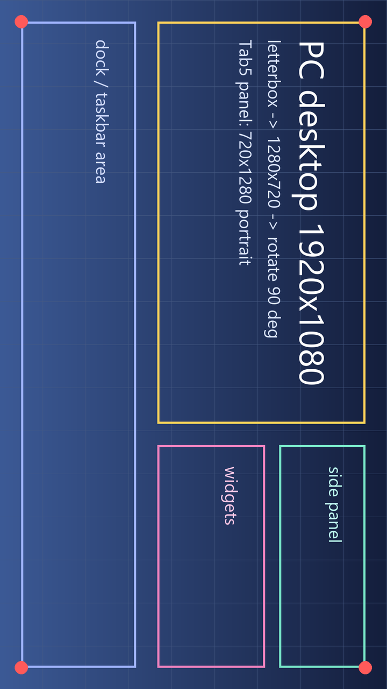

# PC screen → M5Stack Tab5 (ESP32-P4)

A Python script captures the PC desktop, compresses it, and pushes it into the **M5Stack Tab5**'s
ESP32-P4 over USB or Wi-Fi, where it lands in PSRAM and is decoded by the P4's **hardware JPEG
decoder** onto the 5" 1280×720 MIPI-DSI panel.

> Chinese original: [`README.md`](README.md)

```
┌───────────── PC ─────────────┐          ┌──────────── M5Stack Tab5 (ESP32-P4) ────────────┐
│ mss capture                   │          │                                                  │
│   ↓ aspect-fit + letterbox    │  frame   │ scr_reader task: find header → check CRC →        │
│   ↓ rotate 90°                │ protocol │                  store into a PSRAM slot         │
│ Pillow JPEG encode            │ ───────▶ │        ↓ two-slot queue                          │
│   ↓ prepend header + CRC32    │ 22-byte  │ scr_decoder task: hardware JPEG → RGB565          │
│ write serial / TCP socket     │ header   │        ↓ centred blit                            │
│                               │ ◀─────── │ 720×1280 DPI double frame buffer → MIPI-DSI       │
└───────────────────────────────┘ LOG/STAT │ PSRAM: 2×512 KB slots + decode buf + 2 fbs        │
                                └──────────────────────────────────────────────────┘
```

Two links are available; pick one at build time with Kconfig, and change a single flag on the PC side:

| Link | Command | Extra setup | Measured / expected throughput |
| --- | --- | --- | --- |
| **USB-Serial/JTAG** (default) | `--serial COM7` | none - use the same USB-C cable you flash with | USB FS 12 Mbps, roughly 0.5–1 MB/s → about 5–10 fps of 720p JPEG |
| **Wi-Fi + TCP** | `--tcp 192.168.1.50` | the C6 must run ESP-Hosted coprocessor firmware, plus Wi-Fi credentials | SDIO at 40 MHz, clearly faster; limited by decode time |

A 1920×1080 desktop, aspect-fitted into the panel and rotated 90° (the Tab5 panel is natively
portrait 720×1280), ends up like this:



The image above is [`docs/desktop-source.png`](docs/desktop-source.png) (a 1920×1080 mock desktop)
run through the same `render()` path as the sender: scaled to fit 720×1280, rotated 90°, with
letterbox bars - no stretching, no cropping.

---

## Layout

```
firmware/                ESP-IDF project (target esp32p4, M5Stack Tab5)
  CMakeLists.txt
  partitions.csv         16 MB flash, 4 MB application partition
  sdkconfig.defaults     Tab5 P4 silicon revision, PSRAM, DPI double buffering, console setup
  sdkconfig.defaults.wifi  extra defaults for the Wi-Fi/TCP configuration (ESP-Hosted board profile)
  main/
    idf_component.yml    deps: espressif/m5stack_tab5_noglib (panel) + esp_hosted/esp_wifi_remote (Wi-Fi)
    Kconfig.projbuild    link choice, Wi-Fi credentials, buffer sizes, JPEG byte order
    main.c               receive pipeline: reader task + decoder task + STAT reporting
    scr_frame.[ch]       frame header parsing + zlib-compatible CRC32
    scr_display.[ch]     BSP panel bring-up, hardware JPEG decode, letterboxed blit
    scr_link.h           link abstraction (read / write / connected)
    scr_link_usb.c       USB-Serial/JTAG implementation
    scr_link_tcp.c       Wi-Fi + TCP implementation
    scr_wifi.c           esp_wifi_remote (P4 → C6 over SDIO) station bring-up
python/
  screen_stream.py       capture + scale + encode + send (PC-side main program)
  frame_proto.py         frame protocol (Python side, byte-for-byte with the firmware)
  fake_device.py         offline "fake Tab5": validate the sender and the protocol with no board
  test_protocol.py       protocol self-checks: CRC vs zlib, resync after garbage, ...
  requirements.txt
tools/idf.ps1            launcher for this machine's ESP-IDF v5.5.6 (re-exports the env each run)
```

---

## 1. Quick start (USB route, about 5 minutes)

### 1.1 Install the PC-side dependencies

```powershell
cd D:\work_dsh\esp32ser
python -m venv .venv
.\.venv\Scripts\python.exe -m pip install -r python\requirements.txt
```

### 1.2 Build the firmware

```powershell
cd firmware
idf.py set-target esp32p4
idf.py build
```

> On this machine ESP-IDF v5.5.6 lives in `D:\Espressif`, and every pwsh process needs the
> environment re-exported, so the repo ships `tools/idf.ps1`:
>
> ```powershell
> Set-ExecutionPolicy -Scope Process Bypass -Force
> & .\tools\idf.ps1 set-target esp32p4
> & .\tools\idf.ps1 build
> ```
>
> Note that `idf.py` spawns cmake/ninja with piped stdio; in some restricted environments
> (for example the DSH sandbox) that fails with `PermissionError: [WinError 5]` and needs a
> full-access terminal.

### 1.3 Flash the Tab5

The Tab5 is flashed over USB-C. To enter download mode, hold **BOOT** (GPIO35) and tap **RST** -
or simply let esptool reset the board automatically.

```powershell
idf.py -p COM7 flash
```

The COM port that shows up in your browser/Device Manager is the USB-Serial/JTAG interface, and it
is both the flashing port and the data port. You only need to flash once.

### 1.4 Start streaming

```powershell
# see which screens exist, then pick --monitor
.\.venv\Scripts\python.exe python\screen_stream.py --list-monitors

# push the first frame
.\.venv\Scripts\python.exe python\screen_stream.py --serial COM7
```

The desktop should appear on the Tab5 immediately, while the PC prints a statistics line every two
seconds together with the `STAT` lines reported by the board:

```
[pc] frames=42 dropped=0 fps=8.4 link=9200kbps frame=132KB | tab5: seq=41 dec=9.8ms draw=6.1ms fps=8.4 drop=0 badcrc=0 free=28410KB
```

`dec` is the hardware decode time, `draw` is the blit plus panel update, and `free` is the remaining
PSRAM.

### 1.5 Common options

| Option | Meaning |
| --- | --- |
| `--monitor N` | which screen to capture (`--list-monitors` lists them; 0 = the virtual desktop spanning all screens) |
| `--fps 10` | frame-rate cap, 0 = unlimited |
| `--quality 70` | JPEG quality. 55–75 is the sweet spot on USB; higher values cost frame rate |
| `--codec rgb565` | send raw RGB565 with no compression (nothing to decode on the board, but one frame is 1.8 MB - far too slow over USB, Wi-Fi only) |
| `--rotate 90` | clockwise rotation applied after scaling. Default 90 because the Tab5 panel is natively portrait 720×1280; use 270 if the picture ends up the wrong way round |
| `--panel 720x1280` | panel native resolution, normally left alone |
| `--count 100` / `--duration 60` | stop after 100 frames / 60 seconds |
| `--max-frame-kb 512` | per-frame payload limit; must match the firmware's `APP_PAYLOAD_BUFFER_KB` |
| `--dry-run frames.bin` | do not talk to the board, write the byte stream to a file and check it with `fake_device.py` |

---

## 2. Wi-Fi route

The P4 has no radio of its own: Wi-Fi on the Tab5 comes from the on-board **ESP32-C6** (SDIO2,
GPIO8–15), which has to run the **ESP-Hosted coprocessor firmware**. On the P4 side
`esp_wifi_remote` forwards the `esp_wifi` API to it transparently.

`esp_hosted` 2.13.x ships the `M5Stack Tab5 with on-board ESP32-C6` board profile; selecting it gives
the correct pins out of the box: CLK=GPIO12, CMD=GPIO13, D0..D3=GPIO11/10/9/8, reset=GPIO15
(**active low** - the Tab5's C6 reset circuit is low-active, and the default active-high setting keeps
the C6 held in reset, making SDIO enumeration time out with `send_op_cond 0x107`), SDIO interrupt=GPIO14.
All of that lives in `firmware/sdkconfig.defaults.wifi`; nothing has to be filled in by hand.

```powershell
# 1) switch to the TCP transport
idf.py menuconfig
#    Tab5 screen stream -> Link between the PC and the Tab5 -> Wi-Fi + TCP
#    Tab5 screen stream -> Wi-Fi SSID / Wi-Fi password

# or build a second tree straight from the bundled Wi-Fi defaults:
idf.py -B build-wifi -D IDF_TARGET=esp32p4 `
       -D SDKCONFIG=sdkconfig.wifi `
       -D SDKCONFIG_DEFAULTS="sdkconfig.defaults;sdkconfig.defaults.wifi" build

# 2) flash (edit the SSID/password in the Wi-Fi defaults first)
idf.py -p COM7 flash

# 3) the board reports "listening on tcp/8266"; you can also find its IP in the router's DHCP list:
.\.venv\Scripts\python.exe python\screen_stream.py --tcp 192.168.1.50
```

> `esp_hosted` is deliberately pinned to `^2.13`: 3.x has the same board profile, but its package
> nests deeper and exceeds the 260-character Windows path limit, so the component manager fails to
> unpack it (`FileNotFoundError ... host+cp ...`). 2.13.x both unpacks cleanly and carries the Tab5
> board profile, hence the pin.

**Prerequisite (important)**: the C6 must already run ESP-Hosted coprocessor firmware. If the
factory firmware is not ESP-Hosted, `esp_wifi_init()` waits until the handshake times out and the
`LOG`/`STAT` lines report that it cannot connect. In that case flash the coprocessor firmware once
using ESP-Hosted's `eh.py` / `coprocessor/` project (ESP-Hosted also supports letting the P4 OTA the
C6 over SDIO - see the *OTA and system* docs at <https://github.com/espressif/esp-hosted>).
This route is "compiles, complete code path" only; there is no hardware here to test it.

---

## 3. Frame protocol

PC → Tab5 is a byte stream split into frames of "22-byte header + payload", all little-endian:

| Offset | Size | Field | Meaning |
| --- | --- | --- | --- |
| 0 | 4 | magic | ASCII `SCRF` |
| 4 | 1 | version | 1 |
| 5 | 1 | flags | bit0=1: payload is JPEG; =0: raw RGB565 |
| 6 | 4 | seq | frame counter (u32, wraps) |
| 10 | 2 | width | visible width |
| 12 | 2 | height | visible height |
| 14 | 4 | length | payload length in bytes |
| 18 | 4 | crc32 | CRC-32 of the payload (zlib/IEEE) |
| 22 | n | payload | JPEG or RGB565 data |

Tab5 → PC is **text lines** (newline separated) travelling the other way on the same link:

```
LOG waiting for frames on USB-Serial/JTAG - run: python screen_stream.py --serial <PORT>
STAT seq=41 w=720 h=1280 bytes=135160 dec_us=9821 draw_us=6104 fps=8.4 kbps=9200 drop=0 badcrc=0 free_kb=28410 ok=0
```

In the firmware the `crc32` is a hand-written table-driven implementation
(`firmware/main/scr_frame.c`) that matches Python's `zlib.crc32` bit for bit. A failed checksum only
drops that one frame - the receiver rescans for the magic word - so unplugging the cable or an IP
hiccup never corrupts everything that follows.

The hard payload limit is 4 MB, but what actually matters is `APP_PAYLOAD_BUFFER_KB`
(default 512 KB per slot, two slots). A 720×1280 JPEG at `--quality 70` is typically 80–160 KB, so
there is plenty of headroom; raw RGB565 needs 1800 KB for a full panel, so raise that value
(the board has 32 MB of PSRAM).

---

## 4. Key points in the firmware (and the traps behind them)

1. **Chip revision**: Tab5 units ship ESP32-P4 **rev v1.0**, while ESP-IDF 5.5 targets rev ≥ 3.0 by
   default and refuses to boot on a mismatch. `CONFIG_ESP32P4_SELECTS_REV_LESS_V3=y` plus
   `CONFIG_ESP32P4_REV_MIN_100=y` in `sdkconfig.defaults` handle that; changing those two lines
   requires an `idf.py fullclean`. On a rev 3.x board replace them with
   `CONFIG_ESP32P4_REV_MIN_301=y`.
2. **Yielding the console**: the USB-Serial/JTAG RX interrupt pulls received bytes into the console
   ring buffer, so if the console still owns that peripheral we never see the frame data ourselves.
   Hence `CONFIG_ESP_CONSOLE_NONE=y`, with logs forwarded as `LOG` lines over the link. For full boot
   logs switch to `CONFIG_ESP_CONSOLE_UART_DEFAULT=y` (UART0 on GPIO37/38, available on M5-Bus).
3. **Double frame buffering**: `CONFIG_BSP_LCD_DPI_BUFFER_NUMS=2`, so decoding writes into the back
   buffer and the DPI peripheral then switches its scan-out pointer, avoiding tearing while a frame
   is being decoded. `esp_lcd_panel_draw_bitmap()` is passed the frame-buffer pointer itself; the
   driver only flushes the cache and switches, it never copies twice.
4. **Hardware decode and 16-pixel alignment**: the P4 JPEG decoder pads 4:2:0/4:2:2 dimensions up to a
   multiple of 16, so the decode buffer is sized `(w+15)/16*16 × (h+15)/16*16 × 2` and allocated with
   `jpeg_alloc_decoder_mem()` (it satisfies the cache-line and 2D-DMA alignment requirements; a plain
   `malloc` is rejected by the driver). 720×1280 is already 16-aligned, so with the default settings
   there is no extra copy.
5. **Colour byte order**: the decoder can emit RGB565 in either byte order. The default is `BGR`,
   which matches the DSI frame buffer layout. If red and blue are swapped on screen, enable
   `menuconfig → Tab5 screen stream → JPEG decoder emits RGB order`.
6. **Wi-Fi include propagation**: with no local radio on the P4, `esp_wifi_remote` replaces the
   `esp_wifi` implementation with the one that forwards to the C6 and hangs co-processor-specific API
   headers (`injected`) off `esp_wifi`'s link interface. With ESP-IDF 5.5.6 + esp_hosted 2.13 those
   headers were observed *not* reaching `main`'s compile line, so `main/CMakeLists.txt` adds the
   `injected` / `esp_wifi` / `nvs_flash` include directories explicitly, `injected` first so it wins
   over the stock headers. If a different IDF version complains that `esp_wifi.h` is missing, look
   here first.

---

## 5. Verifying without a board

### 5.1 Protocol self-checks

```powershell
.\.venv\Scripts\python.exe python\test_protocol.py
```

```
crc32: firmware algorithm == zlib.crc32  (empty, ASCII vector, random sizes)
header: 22 bytes, magic/version/flags/length/crc round-trip
resync: recovered [2, 3, 4] after garbage, a truncated frame and noise
corrupt payload: rejected by crc, following frames still parsed
device lines: STAT parsed, LOG parsed, noise ignored
all protocol checks passed
```

The first check ports the nibble-table CRC from `firmware/main/scr_frame.c` to Python verbatim and
compares it against `zlib.crc32` bit for bit - that checksum is the only place where the PC side and
the firmware could disagree, and it is now ruled out.

### 5.2 Fake board: the whole send path

`python/fake_device.py` parses the byte stream with the same protocol, so capture, scaling, rotation,
encoding and CRC can all be checked fully offline:

```powershell
# record 20 frames to a file
.\.venv\Scripts\python.exe python\screen_stream.py --dry-run .\frames.bin --count 20

# parse them with the "fake Tab5" and dump the first frame as a PNG
.\.venv\Scripts\python.exe python\fake_device.py --file .\frames.bin --save .\first.png
```

Or use the fake board as a TCP server to exercise the whole send path, reconnects included:

```powershell
.\.venv\Scripts\python.exe python\fake_device.py --listen 8266
.\.venv\Scripts\python.exe python\screen_stream.py --tcp 127.0.0.1:8266 --count 30
```

---

## 6. Troubleshooting

| Symptom | Likely cause / fix |
| --- | --- |
| Black screen after power-up, no output at all | Wrong P4 silicon revision (`ESP32P4_SELECTS_REV_LESS_V3`), or the flash did not take. Run `idf.py -p COMx flash monitor` and check the bootloader for a revision mismatch |
| Panel lit but black while the PC is sending frames | Panel variant mismatch (early ILI9881C + GT911 vs later ST7121/ST7123); the BSP probes for it. A failed probe shows `Unsupported board version` in a `LOG` line |
| "Access denied" when the PC opens the serial port | The port is held by something else (`idf.py monitor`, a serial terminal) - close it and retry |
| The board resets as soon as the port is opened | Some USB serial drivers assert DTR/RTS; the sender already deasserts both. If it still resets, plug in first and then run the script |
| Colours look greenish / reddish overall | Red and blue swapped → enable `APP_JPEG_RGB_ORDER_RGB` |
| Very low frame rate (< 3 fps) | That is the USB FS ceiling: lower `--quality`, lower `--fps`, or move to Wi-Fi. Also check `dec_us` in the `STAT` line - if decoding itself is slow, the rev 1.0 clock is the cause |
| `badcrc` keeps climbing | Link noise / dropped bytes (common under Wi-Fi congestion). Only the corrupt frames are dropped; later frames are unaffected |
| Wi-Fi never connects | No ESP-Hosted coprocessor firmware on the C6, or a wrong SSID/password. First check whether `got ip` appears in the `LOG` lines |

---

## 7. Verification status (stated plainly)

Verified on this machine (ESP-IDF v5.5.6, no board attached):

| Item | Result |
| --- | --- |
| USB configuration build | ✅ `idf.py -B build build` passes, `esp32p4_screen_stream.bin` = 734 KB (82% of the 4 MB app partition free) |
| Wi-Fi/TCP configuration build | ✅ builds with `sdkconfig.defaults.wifi`, image = 818 KB (80% free); the ESP-Hosted Tab5 profile / SDIO / C6 target are all in effect |
| Protocol self-checks | ✅ `python/test_protocol.py` passes (CRC matches zlib bit for bit, resync after garbage) |
| Capture → scale → rotate → JPEG → framing | ✅ `--dry-run` recorded 5 frames, `fake_device.py` parsed 720×1280 JPEGs and rebuilt a PNG |
| Geometry / orientation | ✅ `docs/panel-preview.png`: 1920×1080 fitted into 720×1280 without distortion, rotated 90° |

**Not verified** (needs real hardware): `GetPortNames()` is empty on this machine and no Tab5 is
connected, therefore:

* panel bring-up and automatic panel-variant detection (ILI9881C / ST7121 / ST7123);
* the actual colours of the hardware JPEG decode (whether BGR byte order is really correct);
* real frame rate and sustained USB-Serial/JTAG throughput;
* the Wi-Fi link (which additionally depends on ESP-Hosted coprocessor firmware on the C6).

All of these need a run on the board; the knobs are already in place
(`APP_JPEG_RGB_ORDER_RGB`, `--rotate`, `--quality`, `APP_PAYLOAD_BUFFER_KB`).
